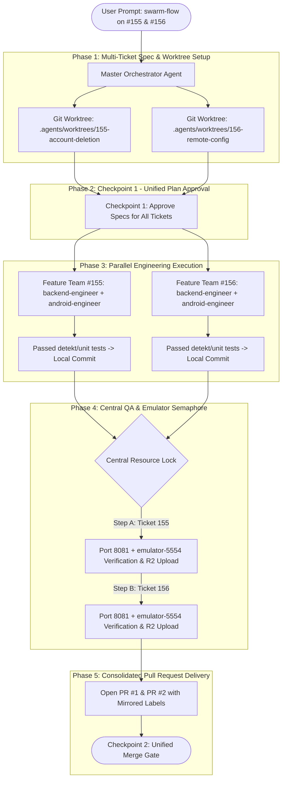

# Swarm Flow (`swarm-flow`)

Hierarchical multi-ticket orchestrator designed to run **2 to 5 independent tickets simultaneously** within a single Antigravity conversation, multiplying delivery throughput while guaranteeing zero git conflicts and zero hardware/port collisions.

Target GitHub Repositories & Project:
- **Backend repo**: `/Users/thanh0x/StudioProjects/course_deals_backend` (`Huythanh0x/course_deals_backend`)
- **Android / KMP repo**: `/Users/thanh0x/StudioProjects/course_deals_ComposeMultiplatform` (`Huythanh0x/course_deals_ComposeMultiplatform`)
- **GitHub Project**: `"Course Deals"` (`PVT_kwHOBEROFc4BhjJ2`, Project #4)

---

## The Core Triad of Swarm Orchestration



---

## 1. Safety Protocols & Invariants

1. **Worktree Isolation (Strict Invariant)**:
   * **Never** allow two concurrent feature tasks to execute in the primary repo working directory.
   * Every ticket runs in its own isolated worktree under `.agents/worktrees/<issue-number>-<slug>`:
     ```bash
     git -C <repo-path> worktree add .agents/worktrees/<issue>-<slug> -b <type>/<issue>-<slug> origin/main
     ```
2. **Module Orthogonality**:
   * Verify that the parallel tickets do not touch the exact same lines of common files (e.g. `AppNavigation.kt` or `libs.versions.toml`). If overlapping changes exist, specify clear non-conflicting sections.
3. **Hardware / Port Semaphore (Sequential Execution for Live Testing)**:
   * **Unit Tests & Detekt**: Run **in parallel** inside each isolated worktree.
   * **Live Port 8081 & Emulator-5554**: Managed strictly **sequentially** by the Master Orchestrator. When Ticket 1 finishes its live E2E check, Ticket 2 gains the lock.

---

## 2. Phase-by-Phase Execution Protocol

### Phase 1: Swarm Initialization & Worktree Setup
For each ticket specified in the batch (e.g., `#155` and `#156`):
1. Read ticket requirements from GitHub issue via `gh issue view`.
2. Create dedicated worktrees in the target repo(s):
   ```bash
   git -C /Users/thanh0x/StudioProjects/CourseDeals/course_deals_ComposeMultiplatform worktree add .agents/worktrees/<issue>-<slug> -b feat/<issue>-<slug> origin/main
   ```
3. Initialize `.agents/tickets/<issue>-<slug>/NOTES.md` inside each worktree.

### Phase 2: Checkpoint 1 (Unified Batch Spec Approval)
Present a consolidated **Swarm Execution Brief** to the user:
- **Tickets in Flight**: List of ticket IDs and titles.
- **Assigned Worktrees**: File system paths.
- **Architectural Summary**: Bullet summary per ticket.
- Call `ask_question`:
  - **(Recommended) Approve swarm plan — launch parallel engineering**
  - **Adjust specific ticket requirements**

### Phase 3: Parallel Subagent Execution
Once approved:
1. Define specialized engineer subagents for each ticket pointing to their respective worktree paths.
2. Invoke the subagents **in the same turn** using `invoke_subagent`.
3. Subagents execute independently:
   - Implement source code & unit tests.
   - Run `./gradlew :app:detekt` and unit tests inside their worktree.
   - Commit locally to the ticket branch.
   - Report commit SHA and test counts back to the Master Orchestrator.

### Phase 4: Central QA Semaphore (Sequential Live Verification)
Once engineer commits are reported:
1. Master Orchestrator locks the test environment.
2. For Ticket 1:
   - Run backend check / bootRun if backend was modified.
   - Run `./gradlew installLocalDebug` on `emulator-5554`.
   - Capture UI state screenshots & upload to Cloudflare R2.
3. Release lock and repeat for Ticket 2.

### Phase 5: Consolidated Delivery & Checkpoint 2
1. Push branches and create GitHub Pull Requests with linked issues (`Closes #<issue>`).
2. Prune completed worktrees:
   ```bash
   git -C <repo-path> worktree remove .agents/worktrees/<issue>-<slug>
   ```
3. Present the **Swarm Delivery Report** with links to all opened PRs.
4. Call `ask_question` for the merge decision.
