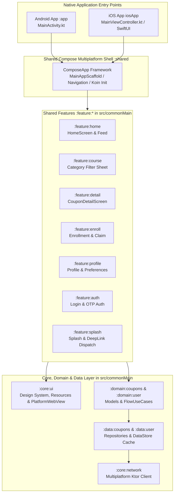

# Course Deals — Multiplatform App (Android & iOS)

A modern, production-grade **Compose Multiplatform (CMP)** and **Kotlin Multiplatform (KMP)** application that aggregates and curates 100% free online course deals and discount coupons (Udemy, Coursera, etc.) in real time.

Both **Android (`:app`)** and **iOS (`iosApp`)** execute the exact same `@Composable` UI screens, StateFlow ViewModels, Clean Architecture UseCases, Koin dependency injection, and Ktor networking from `src/commonMain/kotlin`.

---

## 🏗 Multiplatform Architecture



---

## 🚀 Key Features

* **Multiplatform Shared UI**: 100% shared Compose Multiplatform UI across Android and iOS with native platform bridges (`PlatformWebView`, `NetworkImage`).
* **Real-Time Coupon Discovery**: Continuous paging, multi-category chips, search suggestions, and pull-to-refresh.
* **Offline-First Resilience**: Local data caching via `androidx.datastore:datastore-preferences-core` and Room / in-memory local caching.
* **Authentication**: Passwordless Email OTP authentication, Google Sign-In exchange, and silent token refresh.
* **Frictionless Enrollment**: One-tap coupon code copying to system clipboard with direct deep-linking into provider checkout pages.
* **Theme & Customization**: Dynamic Light / Dark mode toggle using Compose Material 3 colors.

---

## 🛠 Tech Stack

| Layer | Multiplatform Technology |
|---|---|
| **Language & Engine** | Kotlin 2.1+ / Compose Multiplatform |
| **Dependency Injection** | **Koin** (`koin-core`, `koin-compose`, `koin-compose-viewmodel`) |
| **Networking** | **Ktor Client** with `HttpSend` Bearer auth & auto-refresh (OkHttp on Android, Darwin on iOS) |
| **Serialization** | `kotlinx.serialization` (JSON) |
| **Concurrency & Reactive** | Kotlin Coroutines & `StateFlow` |
| **Local Storage** | `androidx.datastore:datastore-preferences-core` |
| **Resource Bundling** | Compose Multiplatform `composeResources` (Shared drawables, strings, fonts) |
| **Build System** | Gradle 9.5 convention plugins (`coursedeals.kmp.library`) |

---

## 💻 Building from Source

### Prerequisites
* **JDK**: Eclipse Adoptium JDK 17 (or Java 17+)
* **Android Studio**: Android Studio Ladybug / Meerkat with KMP plugin
* **Xcode**: Xcode 16+ (for iOS build & simulator runs)
* **CocoaPods / SPM**: Zero external CocoaPods required; Xcode links `:shared` via standard framework embedding.

### Running Android
```bash
./gradlew :app:assembleLocalDebug
# Or run on connected emulator
./gradlew :app:installLocalDebug
```

### Running iOS (Simulator)
```bash
# Compile shared framework for iOS Simulator
./gradlew :shared:linkDebugFrameworkIosSimulatorArm64

# Open and build Xcode project
open iosApp/iosApp.xcodeproj
```

---

## 📚 Documentation & Guides

* **[Product Vision & User Flows](docs/product/README.md)**: Global navigation flowchart, business rules, and route-by-route specifications.
* **[Exhaustive Test Suite (TEST_CASES.md)](docs/product/TEST_CASES.md)**: 38 branch-complete test scenarios covering all UI/ViewModel states.
* **[Production Roadmap](docs/product/ROADMAP.md)**: Upcoming features across Sprints 2, 3, and 4.
* **[Sprint & Project Management](docs/project-management.md)**: Branching, commit conventions, and agile workflows.
