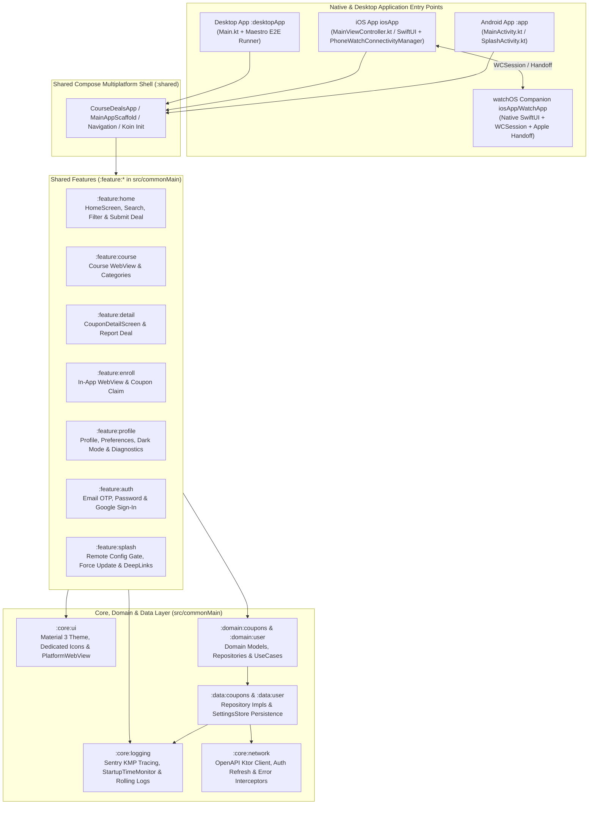

# Course Deals — Multiplatform Client (Android, iOS, watchOS & Desktop)


A production-grade **Compose Multiplatform (CMP)** and **Kotlin Multiplatform (KMP)** application that aggregates and curates verified 100% free online course deals and discount coupons (Udemy, Coursera, etc.) in real time.

**Android (`:app`)**, **iOS (`iosApp`)**, and **Desktop (`:desktopApp`)** execute the exact same `@Composable` UI screens, `StateFlow` ViewModels, Clean Architecture UseCases, Koin dependency injection, OpenAPI-generated Ktor networking, and Sentry observability from `src/commonMain/kotlin`, paired with a native SwiftUI **Apple Watch companion (`iosApp/WatchApp`)** synced via `WatchConnectivity` (`WCSession`) and Apple Handoff.

---

## 🏗 Multiplatform Architecture



---

## 📦 Module Map (17 Gradle Modules + Xcode Workspace)

| Module | Plugin | Role |
|---|---|---|
| `:app` | `com.android.application` | Android entry point (`local` & `prod` flavors), R8 minification, wires Koin & `CourseDealsApp()` |
| `:desktopApp` | `org.jetbrains.kotlin.jvm` + CMP | Compose Desktop (`jvm`) Developer Preview & Dev-Test target (`Main.kt`), embedded Chromium browser (`compose-webview-multiplatform`), CLI deep-linking (`--screen=...`), and Maestro E2E YAML flow runner (`runMaestroFlow`) |
| `iosApp/` & `iosApp/WatchApp/` | Xcode Project (`iosApp.xcodeproj`) | iOS host app embedding `:shared` (`ComposeApp.framework`) + native SwiftUI Apple Watch companion (`WatchApp`) with `/hot-deals` sync & Apple Handoff |
| `:shared` | `coursedeals.kmp.library` + CMP | Shared KMP root (`CourseDealsApp`, `MainAppScaffold`, `MainViewController` for iOS) |
| `:core:common` | `coursedeals.kmp.library` | Shared KMP utilities, dispatchers, `PlatformTime`, and base models |
| `:core:logging` | `coursedeals.kmp.library` | Sentry KMP (`io.sentry:sentry-kotlin-multiplatform`), `CommonTracingInitializer`, `StartupTimeMonitor`, and `DailyRollingFileLogWriter` |
| `:core:ui` | `coursedeals.kmp.library` + CMP | Material 3 design system, custom `DedicatedIconsFilled`/`Outlined`, `ViewModel` error boundary, and `PlatformWebView` |
| `:core:network` | `coursedeals.kmp.library` | Ktor 3 `HttpClient` (`OkHttp` on JVM/Android, `Darwin` on iOS), OpenAPI Generator client (`generateCourseDealsApi`), Bearer auth & refresh interceptors |
| `:domain:coupons` / `:domain:user` | `coursedeals.kmp.library` | Pure `commonMain` domain models, repository interfaces, and use cases |
| `:data:coupons` / `:data:user` | `coursedeals.kmp.library` | Repository implementations, Ktor remote data sources, and `SettingsStore` (`DataStore` on Android/JVM, `NSUserDefaults` on iOS) |
| `:feature:home` / `:course` / `:detail` / `:enroll` / `:profile` / `:auth` / `:splash` | `coursedeals.kmp.library` + CMP | Shared Compose Multiplatform screens and `StateFlow` ViewModels in `src/commonMain/kotlin` |

---

## 🚀 Key Features

* **100% Shared Compose Multiplatform UI**: Shared UI across Android, iOS, and Desktop with native platform bridges (`PlatformWebView`, native share sheets, clipboard).
* **Apple Watch Companion (`WatchApp`)**: Native SwiftUI watchOS experience displaying top `/hot-deals` with student counts, hot badges, Digital Crown navigation, haptic coupon copy, and Apple Handoff (`com.coursedeals.deal.open`) to iPhone/Mac.
* **Real-Time Coupon Discovery & Filtering**: 2-column adaptive grid, multi-category filter chips, language/rating/sort filters, debounced search autocomplete, infinite scroll pagination, and community deal submission/reporting.
* **OpenAPI-Driven Ktor Networking**: Contract-first networking generated via `./gradlew generateCourseDealsApi` from `core/network/openapi/openapi.json` synced with `course_deals_backend`.
* **Authentication & Onboarding**: Passwordless Email OTP, email/password sign-in, Google Sign-In (plus Dev Mode mock auth for local E2E testing), Terms & Privacy consent gating, and automatic silent JWT token refresh.
* **Remote Config & Observability**: Startup remote configuration (`GET /api/v1/app/config`) with unskippable Force Update gate, Sentry multiplatform crash/error reporting, startup time monitoring (`StartupTimeMonitor`), and rolling diagnostic log export.

---

## 🛠 Tech Stack

| Layer | Multiplatform Technology |
|---|---|
| **Language & UI** | Kotlin `2.4.10` / Compose Multiplatform `1.8.0` / AGP `9.3.0` (`compileSdk 37`, `minSdk 24`, `targetSdk 37`) |
| **Dependency Injection** | **Koin `4.0.2`** (`koin-core`, `koin-android`, `koin-compose`, `koin-compose-viewmodel`) |
| **Networking & Codegen** | **Ktor `3.1.1`** (`OkHttp` on Android/Desktop, `Darwin` on iOS) + **OpenAPI Generator `7.12.0`** (`kotlinx.serialization` + `kotlinx-datetime`) |
| **Local Storage** | `SettingsStore` (`androidx.datastore:datastore-preferences-core` `1.2.1` on Android/JVM, `NSUserDefaults` on iOS) & Room `2.8.4` |
| **Image Loading** | **Coil 3** (`coil-compose`, `coil-network-okhttp`, `coil-network-ktor3`) |
| **Observability** | **Sentry KMP `0.29.0`** (`io.sentry:sentry-kotlin-multiplatform`) + custom rolling file logger (`:core:logging`) |
| **Build & Quality** | Gradle `9.5` (JDK 21 daemon, Java 17 target), convention plugins (`build-logic`), Detekt `1.23.6`, Maestro E2E YAML flows |

---

## 💻 Building, Running & Verifying

### Prerequisites
* **JDK**: JDK 17+ (Gradle daemon uses JDK 21 via `gradle/gradle-daemon-jvm.properties`)
* **Android Studio**: Ladybug / Meerkat+ with KMP plugin
* **Xcode**: Xcode 16+ (for iOS & watchOS simulator builds)

### Build & Static Analysis
```bash
# Full multi-module build & unit tests
./gradlew build

# Static analysis across all 17 modules + Android Lint
./gradlew detekt :app:lintLocalDebug

# Regenerate KMP Ktor API models from OpenAPI spec
./gradlew generateCourseDealsApi
```

### Running Targets
```bash
# 1. Android (local flavor pointing to local backend)
./gradlew :app:assembleLocalDebug
./gradlew :app:installLocalDebug

# 2. Compose Desktop (interactive window or automated Maestro E2E flow)
./gradlew :desktopApp:run
./gradlew :desktopApp:runMaestroFlow -Pflow=.maestro/flows/10-desktop-full-regression.yaml -PscreenshotDir=/tmp/desktop-e2e

# 3. iOS & watchOS (Simulator)
./gradlew :shared:linkDebugFrameworkIosSimulatorArm64
open iosApp/iosApp.xcodeproj
```

### Multi-Platform Release Packaging
```bash
# Build signed/minified release artifacts (Android APK, iOS IPA, Desktop DMG) with SHA256 checksums
bash scripts/release-build.sh --version 1.0.0 --platform all
```

---

## 📚 Documentation & Guides

* **[Agent & Architecture Guide (`AGENTS.md`)](AGENTS.md)**: Module map, state management conventions, build/verify commands, and `team-flow` / `sprint-flow` workflows.
* **[Product Overview & Navigation (`docs/product/README.md`)](docs/product/README.md)**: Personas, global navigation flowchart, user journey flows (`docs/product/flows/`), and route specs (`docs/product/routes/`).
* **[Comprehensive Test Suite (`docs/product/TEST_CASES.md`)](docs/product/TEST_CASES.md)**: Branch-complete test cases and declarative Maestro E2E flows (`.maestro/flows/`).
* **[Cross-Platform QA Report (`docs/product/QA_VERIFICATION_REPORT.md`)](docs/product/QA_VERIFICATION_REPORT.md)**: Side-by-side Android & iOS verification matrix and bug resolutions.
* **[Architecture Decision Records (`docs/adr/`)](docs/adr-guide.md)**:
  * [ADR 0001: Kotlin Multiplatform over Flutter](docs/adr/0001-kotlin-multiplatform-over-flutter.md)
  * [ADR 0002: API/DB Versioning and App↔Backend Compatibility](docs/adr/0002-api-db-versioning-and-app-backend-compatibility.md)
  * [ADR 0003: Native SwiftUI and Shared KMP Domain Architecture for watchOS Companion App](docs/adr/0003-watchos-swiftui-kmp-architecture.md)
* **[CI/CD & Release Pipeline (`docs/ci-cd.md`)](docs/ci-cd.md)** & **[Sprint Guide (`docs/SPRINT_GUIDE.md`)](docs/SPRINT_GUIDE.md)**.
