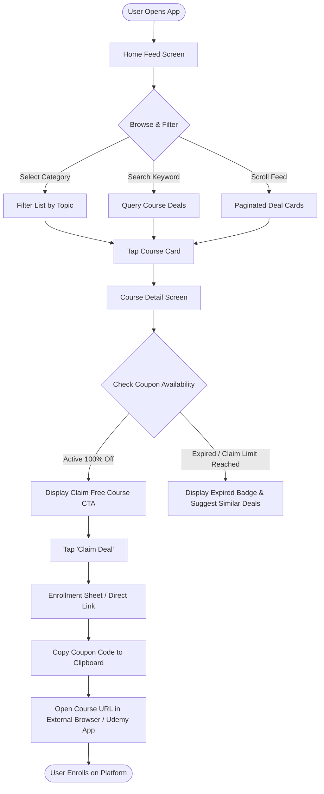
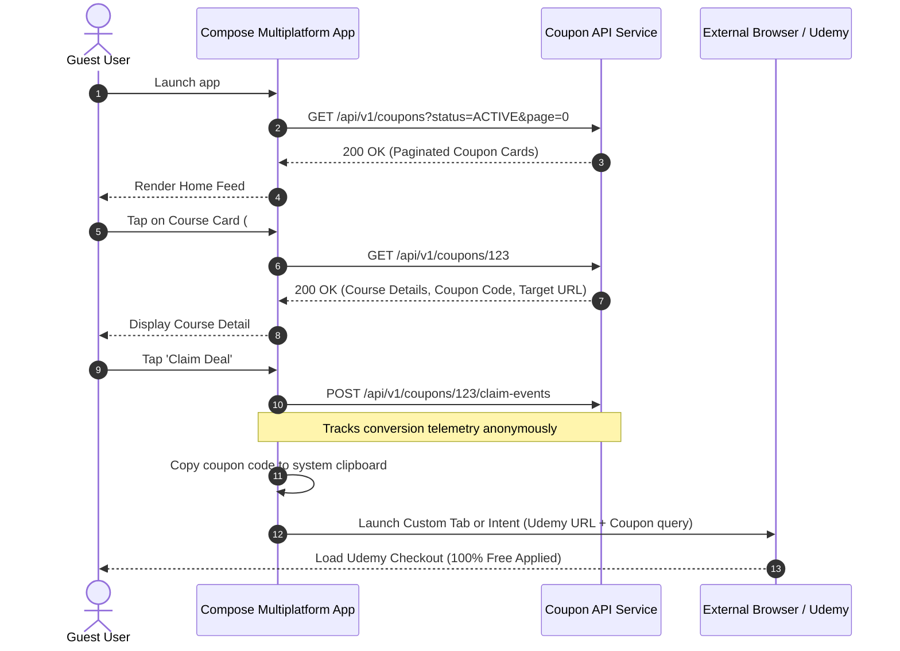

# Flow 01: Guest Discovery to Enrollment

## 1. Overview
The primary conversion funnel in Course Deals allows unauthenticated guests to immediately discover, filter, and redeem free course coupons without mandatory sign-in barriers.

---

## 2. User Journey Flowchart

---

## 3. Sequence Diagram: Interaction Across Layers

---

## 4. Key Business Invariants & Edge Cases
* **Zero Friction**: Guests do not need to register to claim coupon links.
* **Expired Status Guard**: If a coupon expired while the user was viewing the screen, clicking 'Claim Deal' triggers a fresh check or displays a warning banner.
* **Clipboard Notification**: App shows a non-intrusive toast: *"Coupon code copied to clipboard!"*.
