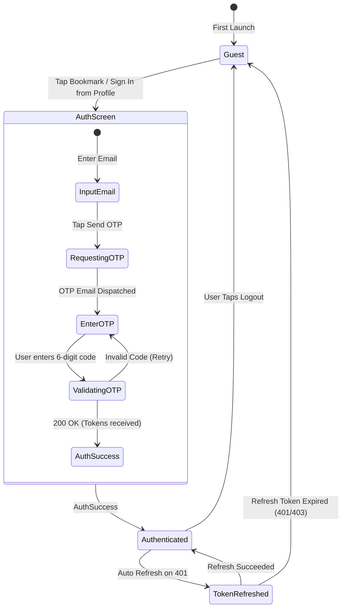
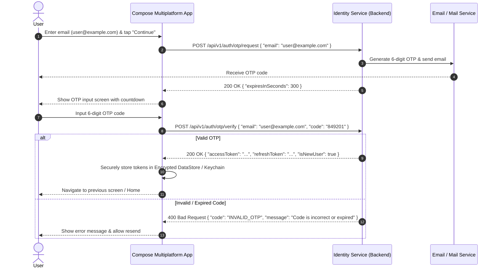

# Flow 02: Authentication & Account Lifecycle

## 1. Overview
Course Deals uses a modern, lightweight authentication model: **Passwordless Email OTP** and **Social OAuth (Google)**. Users authenticate when they want to unlock saved bookmarks, sync preferences across devices, or configure push notifications.

---

## 2. Authentication State Transition

---

## 3. Sequence: Passwordless OTP Authentication Flow

---

## 4. Key Security & Business Rules
* **Token Storage**: `accessToken` and `refreshToken` are stored in platform-secure storage (`EncryptedSharedPreferences` on Android, `Keychain` on iOS).
* **Automatic Silent Refresh**: On any `401 Unauthorized` API response, an Authenticator interceptor triggers `POST /api/v1/auth/refresh` before retrying the original request.
* **Graceful Fallback**: If token refresh fails, clear credentials and downgrade user session to `Guest` without crashing.
