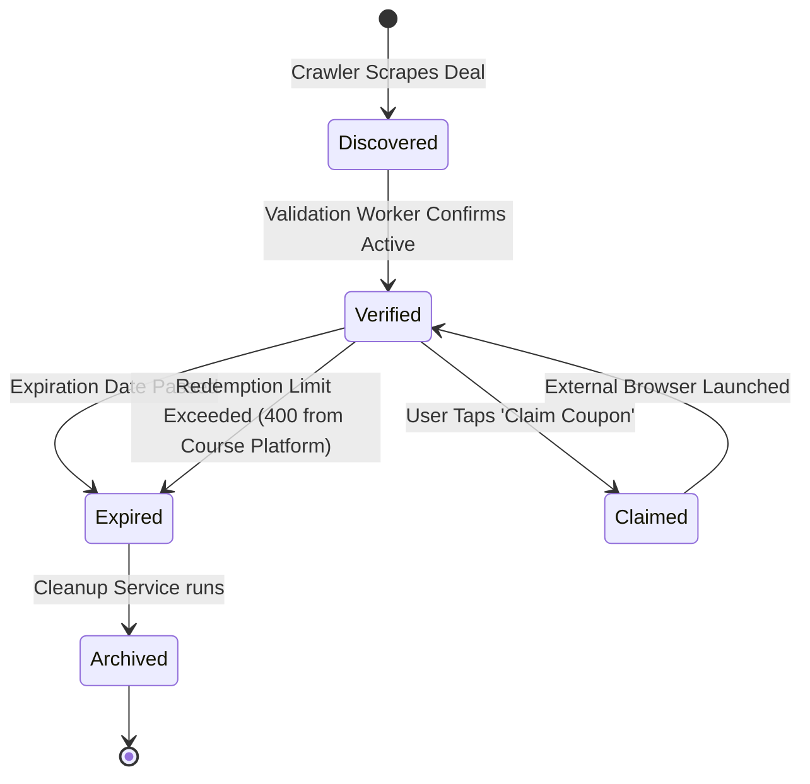
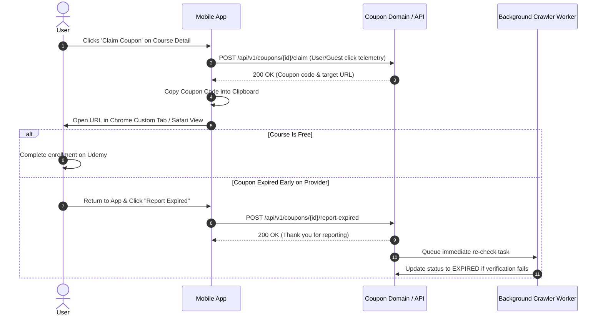

# Flow 03: Coupon Claim & Redemption Lifecycle

## 1. Overview
Coupons on online course platforms (especially Udemy) have volatile lifecycles: they are limited by duration (typically 3 to 5 days) or redemption quantity caps (e.g. max 1,000 redemptions). This flow defines how the app validates, claims, and updates coupon states.

---

## 2. Coupon State Lifecycle

---

## 3. Sequence: Claiming & Reporting Deal Status

---

## 4. Key Rules
* **Smart URL Formatting**: If the course already embeds the coupon code in the URL (`?couponCode=FREE100`), the link directly applies the discount.
* **Redundant Clipboard Copy**: The raw coupon code is always placed into the device clipboard so that users can paste it manually if the web redirect drops query parameters.
* **Community Feedback Loop**: Users can flag dead/expired deals, which lowers deal trust score and triggers automatic re-validation by the crawler daemon.
