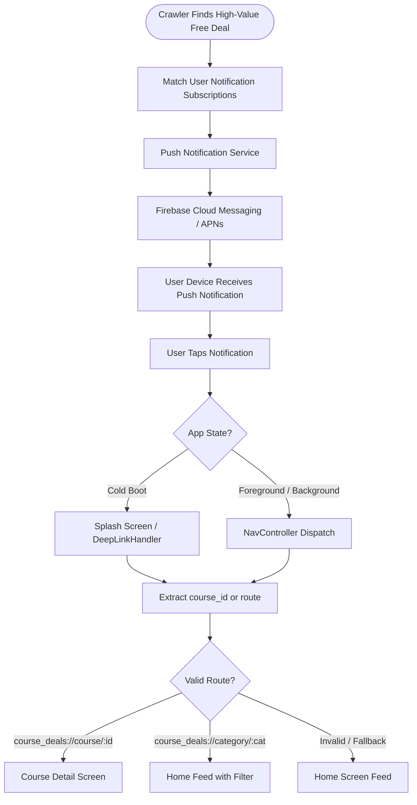
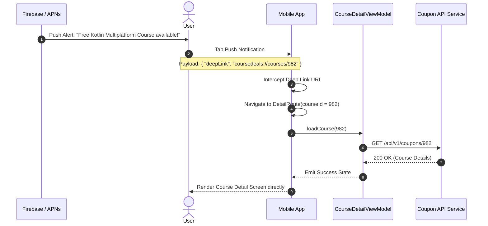

# Flow 04: Push Notification & Deep Linking

## 1. Overview
Users receive push alerts when new 100% free courses matching their subscribed topics are posted, or when a bookmarked course is close to coupon expiration. Tapping notifications directly navigates them to the target course screen.

---

## 2. Notification Dispatch & Deep Link Routing

---

## 3. Sequence: Push Alert Receipt & Navigation

---

## 4. Key Rules
* **Deep Link Schema**: Supports custom URI scheme `coursedeals://` and standard App Links / Universal Links `https://coursedeals.app/courses/{id}`.
* **Cold-Start Resilience**: When opening from a dead app state, the app loads Splash to verify credentials without losing the pending deep link backstack.
* **Notification Preferences**: Users can toggle push notifications per category in their profile settings.
