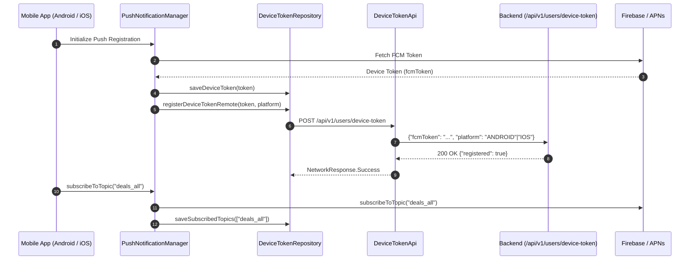
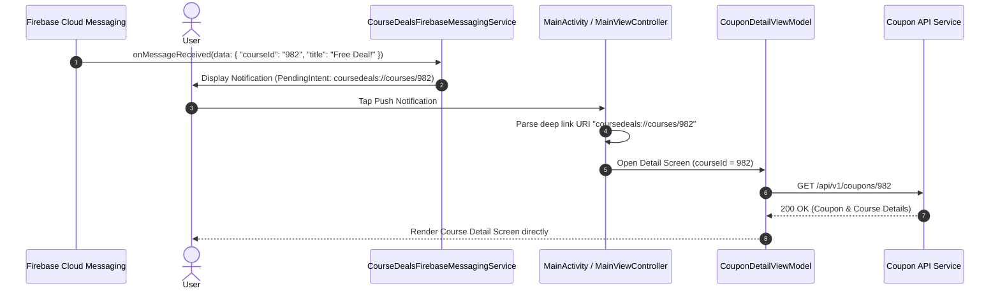

# Flow 04: Push Notification & Deep Linking

## 1. Overview
Users receive push alerts when new 100% free courses matching their subscribed topics are posted, or when a bookmarked course is close to coupon expiration. Tapping notifications directly navigates them to the target course screen.

---

## 2. Multiplatform Architecture

```mermaid
flowchart TD
    subgraph Multiplatform Push Layer [core:common & domain:user]
        PNM[PushNotificationManager Interface]
        DTR[DeviceTokenRepository]
        NT[NotificationTopic: deals_all, deals_development, deals_business, deals_design, deals_it_software]
    end

    subgraph Android Platform [:app]
        APNM[AndroidPushNotificationManager]
        FCMService[CourseDealsFirebaseMessagingService]
        FCM[Firebase Cloud Messaging SDK]
        MainAct[MainActivity Intent Filter: coursedeals://courses/{id}]
        DetailAct[CouponDetailActivity]
    end

    subgraph iOS Platform [:shared / iosApp]
        IPNM[IosPushNotificationManager]
        MainVC[MainViewController handleDeepLink]
        IOSApp[iOSApp / ContentView onOpenURL]
        AppScaffold[AppScreen.Detail Navigation]
    end

    PNM --> APNM
    PNM --> IPNM
    APNM --> FCM
    FCMService --> DTR
    MainAct -->|coursedeals://courses/:id| DetailAct
    IOSApp --> MainVC
    MainVC --> AppScaffold
```

---

## 3. Notification Dispatch & Deep Link Routing

```mermaid
flowchart TD
    Crawler([Crawler Finds High-Value Free Deal]) --> MatchRules[Match User Notification Subscriptions]
    MatchRules --> PushQueue[Push Notification Service]
    PushQueue --> FCM[Firebase Cloud Messaging / APNs]
    FCM --> Device[User Device Receives Push Notification]

    Device --> ClickPush[User Taps Notification]
    ClickPush --> AppEntry{App Platform?}

    AppEntry -->|Android| MainAct[MainActivity onNewIntent / onCreate]
    AppEntry -->|iOS| IOSOpen[iOS onOpenURL / MainViewController]

    MainAct --> ParseDeepLink[Extract course_id from coursedeals://courses/{id}]
    IOSOpen --> ParseDeepLink

    ParseDeepLink --> RouteChoice{Valid Route?}
    RouteChoice -->|coursedeals://courses/:id| DetailScreen[Course Detail Screen]
    RouteChoice -->|Invalid / Fallback| HomeScreen[Home Screen Feed]
```

---

## 4. Sequence: Device Token Registration & Topic Subscription



---

## 5. Sequence: Push Alert Receipt & Navigation



---

## 6. Key Rules & Topics
* **Supported Topics**:
  - `deals_all`: All 100% discount deals
  - `deals_development`: Development & Programming courses
  - `deals_business`: Business & Finance courses
  - `deals_design`: Design & UI/UX courses
  - `deals_it_software`: IT & Software infrastructure
* **Deep Link Schema**: Supports custom URI scheme `coursedeals://courses/{id}`.
* **Master Switch Hierarchy**: Turning off Master Notification mutes/unsubscribes all topic subscriptions. Re-enabling restores user topics or defaults to `deals_all`.
* **Security & Immutability**: All notification `PendingIntent` instances use `FLAG_IMMUTABLE`. Deep links are parsed strictly with numeric course ID validation.
