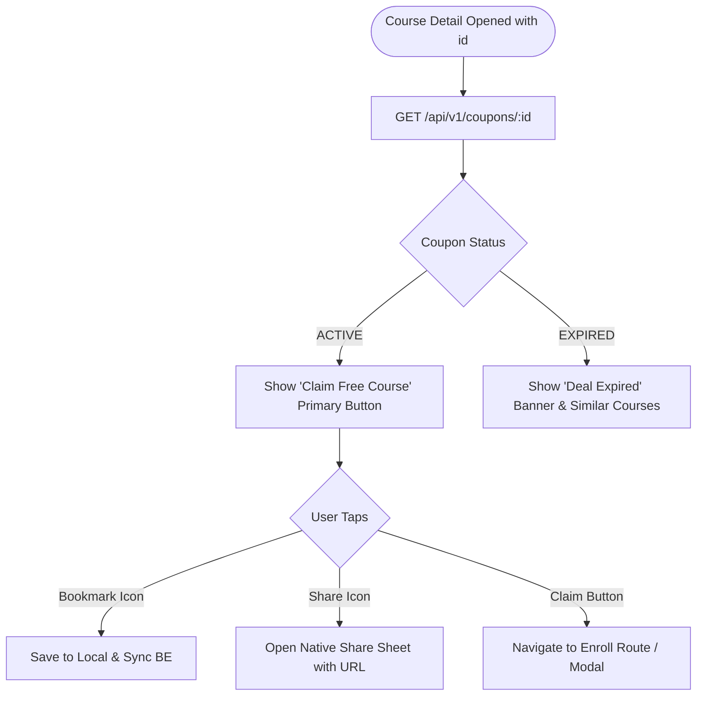

# Route: Course Detail Screen (`feature/detail`)

## 1. Overview
Displays in-depth course information (syllabus highlights, rating, expiration countdown, provider platform) and acts as the gateway to claiming the coupon.

---

## 2. Interaction & State Flow



---

## 3. Screen Components
1. **Course Hero Header**: Cover image, platform badge (e.g. Udemy), course title, instructor name, and star rating.
2. **Pricing & Status Bar**: Original vs. Discounted price (`$0.00 FREE`), countdown pill (*"Ends in 2 days"*).
3. **Action Bar**:
   - `Bookmark` (Heart/Star icon)
   - `Share`
   - `Claim Coupon` (Sticky bottom CTA)
4. **Course Description & Learnings**: Expandable markdown/text summary.

---

## 4. Backend Contracts
* `GET /api/v1/coupons/{id}`
  * **Response (200 OK)**:
    ```json
    {
      "id": "c_101",
      "title": "Mastering Kotlin Coroutines & Flow",
      "description": "Learn asynchronous programming in Kotlin...",
      "code": "NOVFREEKOTLIN",
      "directUrl": "https://www.udemy.com/course/kotlin-coroutines/?couponCode=NOVFREEKOTLIN",
      "platform": "UDEMY",
      "status": "ACTIVE",
      "expiresAt": "2026-11-03T12:00:00Z"
    }
    ```
