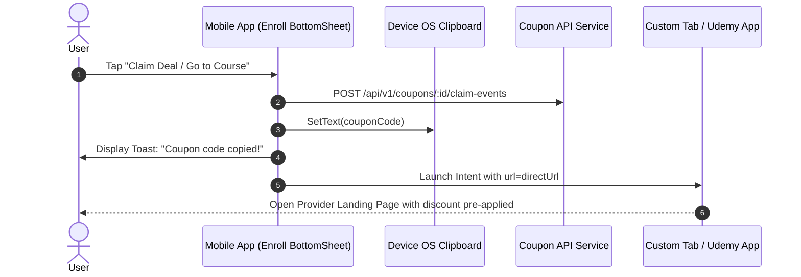

# Route: Enroll & Claim Screen (`feature/enroll`)

## 1. Overview
The terminal action of the coupon redemption funnel. Handles copying coupon codes, firing claim telemetry, and redirecting the user to the course platform (Udemy) via Chrome Custom Tabs, Safari View Controller, or the native Udemy application.

---

## 2. Enrollment Flow



---

## 3. Screen Behavior
* Typically presented as an animated **Modal BottomSheet** over the detail view, or directly triggers the intent with a brief confirmation animation.
* Displays a quick instruction: *"We copied the code for you in case it's not applied automatically!"*.
* Includes a **"Report Expired"** secondary button if the user returns to the app and found the code no longer valid on Udemy.

---

## 4. Backend Contracts
* `POST /api/v1/coupons/{id}/claim-events`
  * **Payload**:
    ```json
    {
      "source": "MOBILE_APP",
      "platform": "ANDROID"
    }
    ```
  * **Response (200 OK)**:
    ```json
    { "success": true }
    ```
