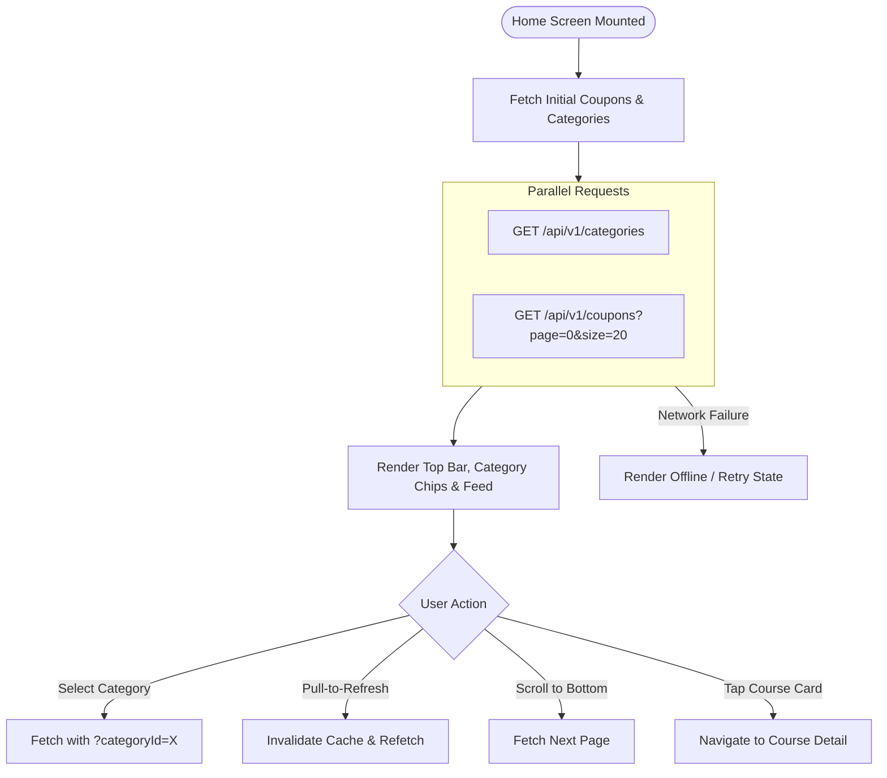

# Route: Home Screen (`feature/home`)

## 1. Overview
The primary landing and browsing screen. Presents curated, active deals with horizontal category chips, search/filtering, and endless scroll pagination.

---

## 2. Architecture & Data Flow



---

## 3. Screen States
* **Shimmer / Skeleton**: Display card placeholder skeletons while coupons load.
* **Success Feed**: LazyColumn with Course Deal Cards (Title, Author, Original Price, 100% OFF badge, Expiration timer).
* **Empty State**: Friendly illustration displayed if no deals match the active filter or search query.
* **Pull-to-Refresh**: SwipeRefresh indicator syncs with latest crawled deals.

---

## 4. Backend Contracts
* `GET /api/v1/coupons`
  * **Query Params**: `page` (int), `size` (int), `categoryId` (optional string), `sort` (`newest`, `popular`, `expiring_soon`).
  * **Response (200 OK)**:
    ```json
    {
      "items": [
        {
          "id": "c_101",
          "title": "Mastering Kotlin Coroutines & Flow",
          "instructor": "Jane Doe",
          "originalPrice": 84.99,
          "discountPrice": 0.00,
          "rating": 4.8,
          "enrolledStudents": 1420,
          "expiresAt": "2026-11-03T12:00:00Z",
          "thumbnailUrl": "https://..."
        }
      ],
      "page": 0,
      "totalPages": 5,
      "totalElements": 95
    }
    ```
