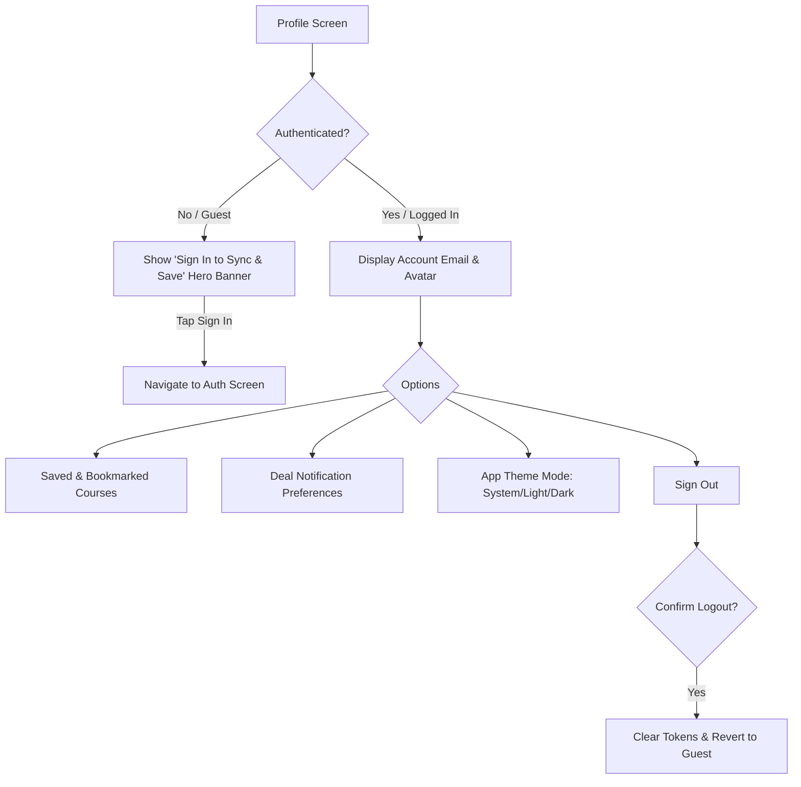

# Route: Profile & Settings Screen (`feature/profile`)

## 1. Overview
Allows users to manage account details, view bookmarked course deals, configure push notification alert rules, and view app information (terms, privacy, version).

---

## 2. Navigation & Actions



---

## 3. Screen Sections
1. **User Identity Header**: Displays email address and membership badge (or a high-contrast login card for guests).
2. **Saved Deals Entry**: Direct navigation to saved offline/online coupons.
3. **Preferences**:
   - Push notification toggles by topic (e.g. Development, Business, Design, IT & Software).
   - Frequency settings (Instant vs. Daily Digest).
4. **App Info**: Version number, open-source licenses, privacy policy, and bug report links.

---

## 4. Backend Contracts
* `GET /api/v1/users/me`
* `GET /api/v1/users/me/bookmarks`
* `PUT /api/v1/users/me/notification-preferences`
  * **Payload**:
    ```json
    {
      "enabledCategories": ["DEVELOPMENT", "DESIGN"],
      "instantAlerts": true
    }
    ```
