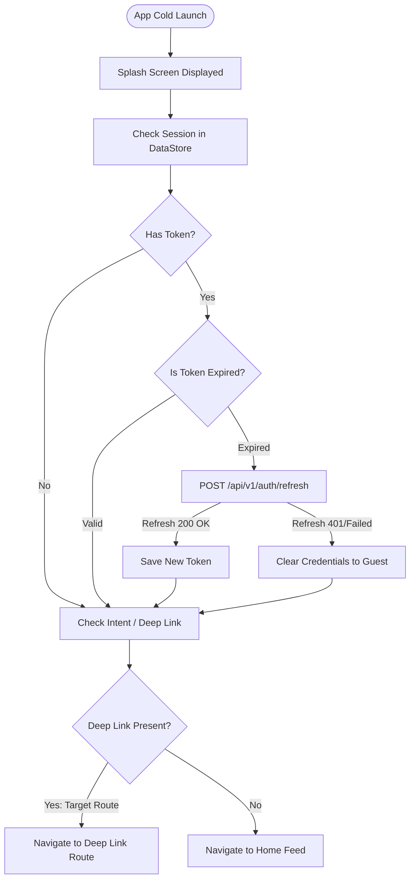

# Route: Splash Screen (`feature/splash`)

## 1. Overview
The entry point on cold start. Responsible for initializing app dependencies, validating or refreshing authentication credentials, reading dynamic/deep link parameters, and dispatching the user to the correct initial route.

---

## 2. State & Navigation Flow



---

## 3. Screen States
| State | Trigger | UI Presentation |
|---|---|---|
| **Loading** | Initial startup | App branding logo, subtle animated loading indicator. |
| **Error / Network Offline** | Critical startup config failure | Retry button with option to continue offline. |
| **Complete** | Checks finished | Navigates immediately with slide/fade transition to target screen. |

---

## 4. Backend Contracts
* `POST /api/v1/auth/refresh`
  * **Request Header**: `Authorization: Bearer <refreshToken>`
  * **Response (200 OK)**:
    ```json
    {
      "accessToken": "ey...",
      "refreshToken": "ey...",
      "expiresInSeconds": 3600
    }
    ```
