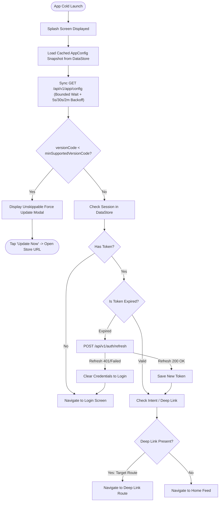

# Route: Splash Screen (`feature/splash`)

## 1. Overview
The entry point on cold start. Responsible for initializing app dependencies, evaluating remote app configuration and minimum version requirements (`FeatureFlagManager`), validating or refreshing authentication credentials, reading dynamic/deep link parameters, and dispatching the user to the correct initial route.

---

## 2. State & Navigation Flow



---

## 3. Screen States
| State | Trigger | UI Presentation |
|---|---|---|
| **Loading** | Initial startup | App branding logo (`splash_screen`), subtle animated loading indicator. |
| **Force Update Required** | `currentVersionCode < minSupportedVersionCode` | Unskippable full-screen modal overlay (`force_update_modal`) with title `"Update Required"`, message, and `"Update Now"` CTA (`force_update_button`) launching `forceUpdateUrl`. |
| **Offline / Degraded Config Sync** | `GET /api/v1/app/config` fails or times out | Proceeds using cached `DataStore` snapshot (or safe compiled defaults) while `FeatureFlagManager` retries in background (`5s, 30s, 2m`). |
| **Complete** | `currentVersionCode >= minSupportedVersionCode` & auth check finished | Navigates immediately to `MainActivity` (when token present) or `LoginActivity` (when token absent). |

---

## 4. Backend Contracts
* `GET /api/v1/app/config` (Public — no `Authorization` header required)
  * **Response (200 OK)**:
    ```json
    {
      "minSupportedVersionCode": 105,
      "latestVersionCode": 106,
      "forceUpdateUrl": "https://play.google.com/store/apps/details?id=com.thanh0x.coursedeals",
      "featureFlags": {
        "clientVerificationEnabled": false,
        "communityReportsEnabled": true,
        "preferExternalBrowserCheckout": false,
        "enrollFlowReportThreshold": 0.3
      }
    }
    ```
* `POST /api/v1/auth/refresh`
  * **Request Header**: `Authorization: Bearer <refreshToken>`
  * **Response (200 OK)**:
    ```json
    {
      "accessToken": "ey...",
      "refreshToken": "ey...",
      "expiresInSeconds": 3600
    }
    ```
